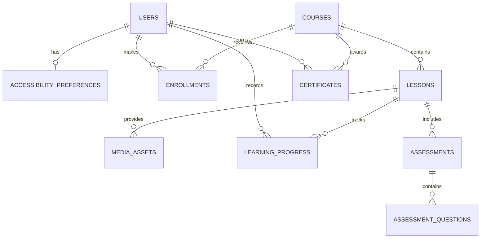

# AccessLearn Ethiopia
## Database Design Document

**Version:** 1.0  
**Database:** PostgreSQL  
**ORM:** SQLAlchemy

---

## 1. Database Overview

The database will store user accounts, accessibility preferences, course information, learning activities, progress, certificates and career opportunities.

Large media files will be stored outside the relational database. Their metadata and storage references will be recorded in PostgreSQL.

## 2. Main Entities

### 2.1 Users

Stores registered platform users.

| Field | Type | Description |
|---|---|---|
| id | UUID | Primary key |
| full_name | VARCHAR | User's name |
| email | VARCHAR | Unique email |
| password_hash | VARCHAR | Secure password hash |
| role | VARCHAR | User role |
| created_at | TIMESTAMP | Account creation time |
| updated_at | TIMESTAMP | Last update |

### 2.2 Accessibility Preferences

Stores individual accessibility settings.

| Field | Type | Description |
|---|---|---|
| id | UUID | Primary key |
| user_id | UUID | Foreign key |
| preferred_language | VARCHAR | Preferred language |
| caption_enabled | BOOLEAN | Caption preference |
| caption_size | VARCHAR | Caption size |
| caption_color | VARCHAR | Caption color |
| contrast_mode | VARCHAR | Contrast preference |
| text_scale | DECIMAL | Text scaling preference |

### 2.3 Courses

Stores learning course information.

| Field | Type | Description |
|---|---|---|
| id | UUID | Primary key |
| title | VARCHAR | Course title |
| description | TEXT | Course description |
| level | VARCHAR | Learning level |
| thumbnail | VARCHAR | Image reference |
| source | VARCHAR | Internal or Savanna |
| external_id | VARCHAR | External course identifier |
| created_at | TIMESTAMP | Creation time |

### 2.4 Lessons

Stores lessons belonging to courses.

| Field | Type | Description |
|---|---|---|
| id | UUID | Primary key |
| course_id | UUID | Course foreign key |
| title | VARCHAR | Lesson title |
| description | TEXT | Lesson description |
| content_html | TEXT | Accessible HTML content |
| sequence_number | INTEGER | Lesson order |
| estimated_duration | INTEGER | Duration in minutes |

### 2.5 Media Assets

Stores metadata for accessible media alternatives.

| Field | Type | Description |
|---|---|---|
| id | UUID | Primary key |
| lesson_id | UUID | Lesson foreign key |
| media_type | VARCHAR | Video, audio, caption, transcript, EthSL |
| language | VARCHAR | Media language |
| storage_reference | TEXT | Media location |
| format | VARCHAR | File format |
| file_size | BIGINT | File size |
| verified | BOOLEAN | Content verification status |

Media types and languages will use validated values.

### 2.6 Enrollments

Connects users with courses.

| Field | Type | Description |
|---|---|---|
| id | UUID | Primary key |
| user_id | UUID | User foreign key |
| course_id | UUID | Course foreign key |
| status | VARCHAR | Enrollment status |
| enrolled_at | TIMESTAMP | Enrollment date |

A user should not have duplicate active enrollments for the same course.

### 2.7 Learning Progress

Stores lesson completion information.

| Field | Type | Description |
|---|---|---|
| id | UUID | Primary key |
| user_id | UUID | User foreign key |
| lesson_id | UUID | Lesson foreign key |
| status | VARCHAR | Not started, in progress, completed |
| completion_percentage | DECIMAL | Progress percentage |
| last_position | DECIMAL | Media position where applicable |
| updated_at | TIMESTAMP | Last update |

A unique user and lesson combination should prevent duplicate progress records.

### 2.8 Assessments

Stores assessment information.

| Field | Type | Description |
|---|---|---|
| id | UUID | Primary key |
| lesson_id | UUID | Lesson foreign key |
| title | VARCHAR | Assessment title |
| description | TEXT | Instructions |
| passing_score | DECIMAL | Required passing score |

### 2.9 Assessment Questions

| Field | Type | Description |
|---|---|---|
| id | UUID | Primary key |
| assessment_id | UUID | Assessment foreign key |
| question_text | TEXT | Question |
| question_type | VARCHAR | Question type |
| options | JSONB | Available options |
| correct_answer | JSONB | Correct answer data |

Correct answers must not be exposed through ordinary learner-facing question responses.

### 2.10 Certificates

| Field | Type | Description |
|---|---|---|
| id | UUID | Primary key |
| user_id | UUID | User foreign key |
| course_id | UUID | Course foreign key |
| verification_code | VARCHAR | Unique verification code |
| issued_at | TIMESTAMP | Issue date |
| status | VARCHAR | Certificate status |

### 2.11 Jobs

Stores career opportunities.

| Field | Type | Description |
|---|---|---|
| id | UUID | Primary key |
| title | VARCHAR | Job title |
| organization | VARCHAR | Organization |
| description | TEXT | Job description |
| location | VARCHAR | Job location |
| application_url | TEXT | Application link |
| audio_summary | TEXT | Audio reference |
| created_at | TIMESTAMP | Publication date |

## 3. Entity Relationships

- One user can have one accessibility preference record.
- One user can enroll in many courses.
- One course contains many lessons.
- One lesson can contain many media assets.
- One user can have progress records for many lessons.
- One lesson can have assessments.
- One assessment can contain many questions.
- One user can earn multiple certificates.
- One course can be associated with certificates earned by many users.

## 4. Relationship Diagram

## 5. Database Constraints

- All primary keys must be unique.
- User email addresses must be unique.
- Foreign keys must reference valid records.
- Completion percentages must remain between 0 and 100.
- Certificate verification codes must be unique.
- Enrollment duplicates must be prevented.
- Progress records must be unique per user and lesson.
- Required fields must not accept null values.

## 6. Data Integrity and Security

- Passwords must never be stored in plaintext.
- Learner information must be protected.
- Authorization must be checked before accessing private records.
- Assessment answers must be protected.
- External platform identifiers must be stored separately from internal IDs.
- Database migrations must be version-controlled.

## 7. Offline Synchronization

Offline progress updates will be queued on the client.

Each update should include:
- A unique operation identifier.
- User and lesson references.
- Updated progress information.
- A timestamp.
- Synchronization status.

The backend must handle repeated synchronization requests safely.

## 8. Future Extensions

The schema may later support:

- Learning analytics.
- Saved lessons.
- Bookmarks.
- Discussion forums.
- More accessibility preferences.
- Additional external learning platforms.

New entities should only be introduced when supported by actual requirements.

